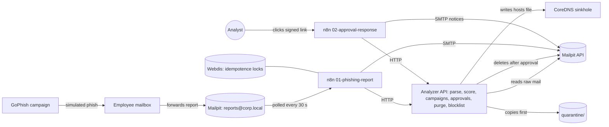
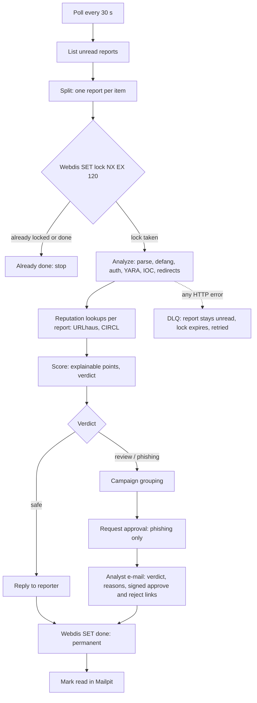
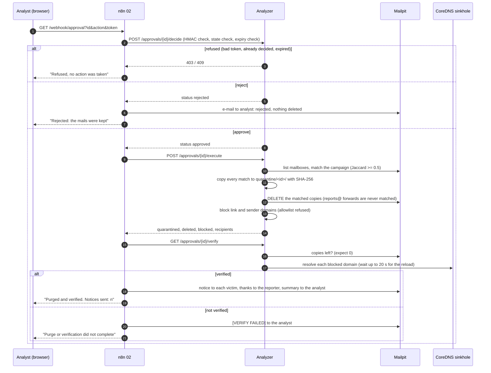

# Architecture

Phishing report box: an employee forwards a suspicious mail to `reports@corp.local`. Software reads it,
scores it with written reasons, groups the reports of one campaign, asks an analyst to decide, deletes
the copies from every mailbox only after that decision, blocks the domains in DNS, and checks that both
actions took effect. Everything runs locally in Docker Compose. No external service is needed.

## Components

| Component | Role | Port (lab) |
|---|---|---|
| Mailpit | fake mail server: the reports inbox, employee mailboxes, analyst and SOC mail | UI 8025, SMTP 1025 |
| n8n | orchestration: two workflows, webhook for the analyst's decision | 5678 |
| Webdis | Redis over HTTP: the per-report lock and the done marker | 7379 |
| Analyzer (FastAPI) | the only component that reads mail bytes, scores, groups, approves, purges, blocks | 8000 |
| CoreDNS sinkhole | answers from the analyzer's blocklist file (`0.0.0.0`) | 5353 (DNS) |
| GoPhish | demo phishing campaign on `.test` domains (training page, no credentials captured) | 3333 admin, 8081 pages |

## Workflow 1: intake, analysis and verdict (`01-phishing-report`)

The report is marked read only after the verdict action succeeded. A failure leaves it unread, and
the lock expires after 120 s, so the next poll retries it. HTTP calls retry three times; the e-mail
nodes never retry, so a retry cannot send a second mail.

## Workflow 2: the analyst's decision (`02-approval-response`)

## Safety rules (enforced in code, not only in the workflow)

| Rule | Where it is enforced | Test |
|---|---|---|
| Nothing is deleted without an approved record | `POST /approvals/{id}/execute` returns 409 unless `approved` | `test_execute_refused_without_approval` |
| A decision link works once | status must be `pending`; second use returns 409 | `test_decision_can_only_be_used_once`, live replay refused |
| A link expires after 10 minutes and changes nothing | expiry check; the request becomes `expired` | `test_expired_approval_is_refused_and_nothing_is_purged`, live timeout run |
| A link cannot be forged or swapped (approve ↔ reject) | HMAC-SHA256 over id, action and expiry, key in `.env` | `test_forged_or_swapped_token_is_refused` |
| Copies are saved before deletion; no copy, no delete | quarantine write happens first; a failed write stops the run | purge test, `restore.py` checksum check |
| Allowlisted domains are never blocked | `is_allowed()` in `block()` and in `_block_targets()` | `test_allowlisted_domain_is_refused` |
| Only one decision per campaign | check and insert in one lock section | `test_second_report_of_same_campaign_reuses_pending_approval`, live run |
| The reporter's own copy is kept and only the campaign copies go | `MAILBOX_EXCLUDED` (reports@, analyst@, soc@) | purge test, live run |
| Links are never opened | the analyzer only reads bytes; nested redirect links are extracted, not fetched | `test_link_hidden_in_redirect_parameter...` |

## Decisions and deviations from the guide

- **Phishing threshold 40 instead of 60.** The guide's 60 reached recall 0.23 on the labelled set; 40 gives
  0.77 with no false alarm on the legitimate mails. The set is synthetic and was used to choose the value,
  so the number is optimistic. One constant (`T_PHISH` in `analyzer/app.py`) changes it back.
- **Redirect wrappers** add +10 and their hidden link is scored like any other link.
- **Disabled vs unavailable.** A missing URLhaus key is recorded as `disabled` (no downgrade); a configured
  source that fails is `unavailable` (never `safe`). See the README.
- **Approval timeout = no action.** The request expires after `APPROVAL_TTL_SECONDS` (default 600). Nothing
  is sent to the analyst at expiry; the analyst's link answers "expired". A scheduled reminder is not built.
- **One reporter gets the thanks.** The approval belongs to the first report of a campaign; the other
  reporters are not thanked by mail yet (listed as a limit).
- **DFIR-IRIS is not integrated.** The guide suggests it for the campaign folder. The folder here is the
  campaign record in SQLite plus the analyst e-mail. IRIS needs its own database and about 4 GB of RAM,
  which the lab does not have to spare; it is the natural next step.
- **Purge scope.** Only copies in employee mailboxes that are in the same campaign (Jaccard ≥ 0.5 on subject,
  sender domain, link domains and attachment hashes). Copies in `reports@` (the forwards) are kept as evidence.
